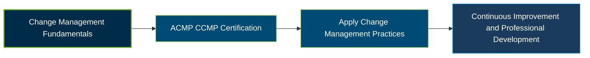

# ACMP Certified Change Management Professional (CCMP) Certification Exam Guide

A dedicated study guide and professional reference repository for candidates preparing for the **ACMP Certified Change Management Professional (CCMP) Certification Exam**, focused on organizational change management principles and practical application.

---

## Exam Overview

The CCMP certification validates professional knowledge and experience in applying recognized change management practices, guided by ACMP's *Standard for Change Management* and Code of Ethics.

- **Exam Format**: Multiple-choice exam, available online or at a Kryterion testing center.
- **Target Audience**: Change management practitioners, project managers, organizational development professionals, HR specialists, and transformation leaders.
- **Prerequisites**: Relevant education and professional change management experience, plus 21 hours of change management training aligned with the Standard.

---

## Core Exam Domains & Knowledge Areas

### 1. Evaluate Change Impact and Organizational Readiness

- Assess organizational context, stakeholders, and the impact of proposed change.
- Evaluate readiness, capacity, and potential barriers to change.
- Identify risks and factors that may influence adoption.

### 2. Formulate Change Strategy

- Define change objectives and align them with organizational goals.
- Select suitable approaches based on the change context and assessment findings.
- Establish measures for evaluating change outcomes.

### 3. Develop Change Management Plan

- Plan stakeholder engagement, communication, and training activities.
- Coordinate resources, roles, responsibilities, and implementation activities.
- Address resistance, risks, and change readiness.

### 4. Execute Change Management Plan

- Implement communication, engagement, and learning activities.
- Monitor adoption, feedback, and progress against intended outcomes.
- Adapt activities in response to emerging risks and stakeholder needs.

### 5. Complete Change Management Effort

- Evaluate outcomes against change objectives and success measures.
- Support sustained adoption and transition to ongoing operations.
- Capture lessons learned and complete change-related activities.

---

## Certification Path

The sequence below is a suggested professional learning progression, not an official ACMP certification ladder.

---

## Recommended Practice & Study Resources

Use current official materials alongside practical application and independent knowledge checks to prepare for the CCMP exam.

- **CertsGate**: Explore [ACMP CCMP certification preparation resources](https://certsgate.com/exams/acmp-global/ccmp) for supplementary study materials and practice questions.
- **Practical Study**: Apply change management concepts to a real or hypothetical organizational change, assessing stakeholder impact, readiness, engagement, implementation, and outcomes.
